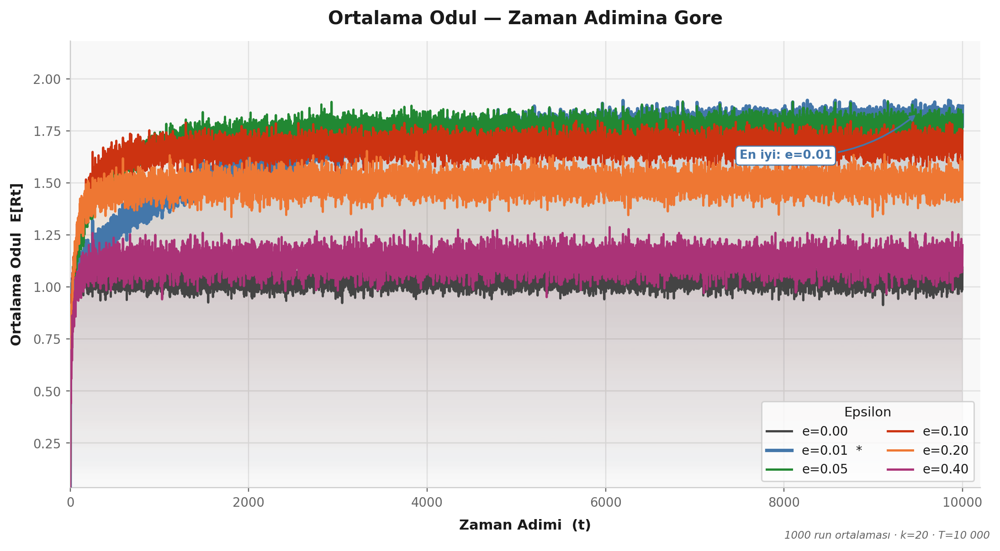
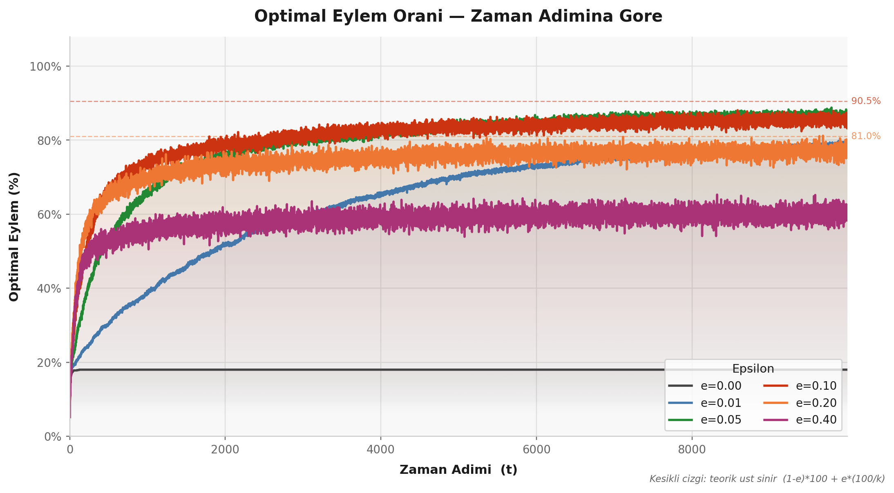
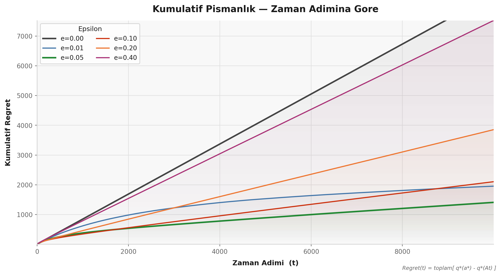
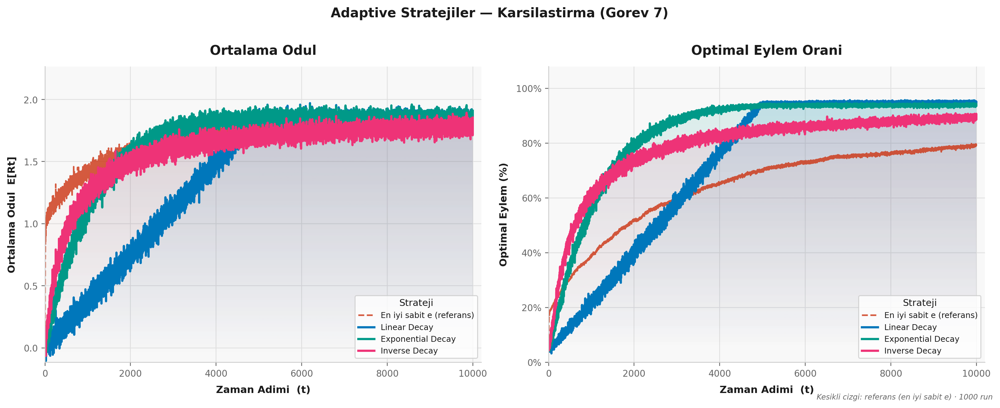
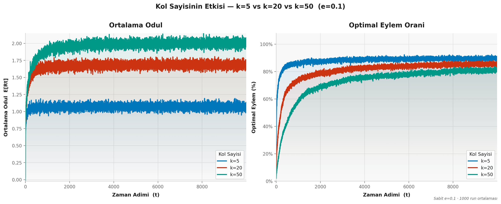
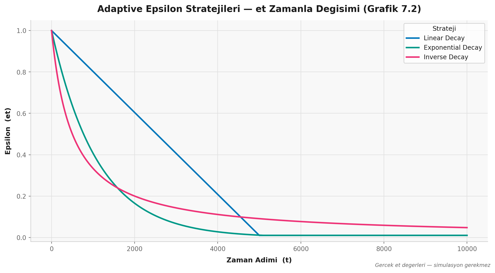
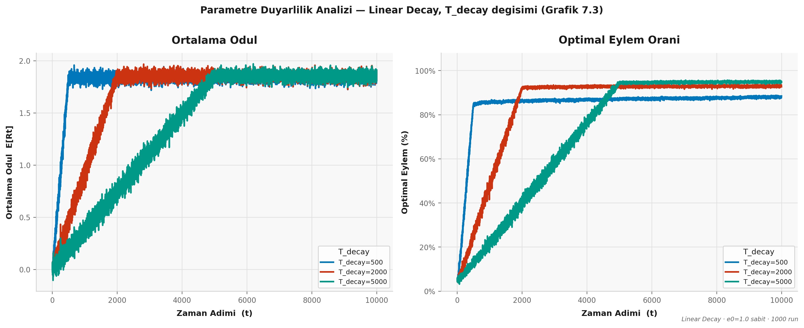

# ε-Greedy Yönteminin Uygulanması ve Adaptive Epsilon Stratejileri

Yunus Emre Arı

## 1. Giriş

Bu ödevde Multi-Armed Bandit problemini ε-Greedy algoritmasıyla çözdüm. k tane kol var, her adımda bir kol seçiyorsun, seçtiğin koldan gürültülü bir ödül geliyor. Amaç zamanla en iyi kolu bulmak ve onu seçmeye devam etmek.

Buradaki temel soru şu: yeni kolları keşfetmek için zaman harcayayım mı (exploration), yoksa şu an en iyi bildiğim kolu seçmeye devam mı edeyim (exploitation)? ε-Greedy bunun en sade çözümü — ε olasılıkla rastgele bir kol seç, geri kalan zamanda en yüksek tahminli kolu seç.

## 2. Kodla İlgili Birkaç Not

Sadece NumPy ve Matplotlib kullandım, hazır RL kütüphanesi kullanmadım. Her şeyi sıfırdan yazmak istediğim için — neyin ne yaptığını anlamak açısından çok daha faydalı oldu.

Seed: `numpy.random.default_rng(42)` ile başladım, her run için buradan alt seed'ler türettim. Böylece kodu tekrar çalıştırınca aynı grafikleri alabiliyorum.

Tie-breaking: İlk başta düşünmediğim bir şeydi bu. `np.argmax` birden fazla kol aynı Q değerine sahipse her zaman ilk indeksi döndürüyor — yani hep aynı kola yöneliyorsun, hiçbir şey öğrenmemişken bile. `np.flatnonzero(Q == max_q)` ile eşit değerli kolları bulup aralarından rastgele seçince bu sorun ortadan kalkıyor [Sutton & Barto, 2018, s.27].

Incremental güncelleme: Q tahminlerini şu formülle güncelliyorum:

> Q(n+1) = Q(n) + (1/n) · [R(n) − Q(n)]

Matematiksel olarak "tüm geçmiş ödüllerin ortalaması" ile aynı sonucu veriyor ama geçmiş ödülleri saklamamıza gerek kalmıyor. Her adımda sadece bir çıkarma ve bir çarpma işlemi — bellek ve hesap açısından çok verimli.

## 3. Neden Bu Parametreleri Seçtim?

### k = 20

İlk başta k=10 denemedim değil, ama 20'ye karar verdim çünkü şunlar önemli:

k=5 olsa problem çok kolay kalıyor. 5 kolda greedy bile kısa sürede iyi kolu buluyor, epsilon'ların farkı neredeyse göremiyorsun. k=50 ise çok fazla — 10.000 adımda her kolu yeterince ziyaret edemiyorsun, eğriler hâlâ gürültülü.

k=20'de optimal kolu rastgele seçme ihtimalin başta %5. Bu yeterince zor ama çözülebilir. Farklı epsilon'ların farkı bu noktada en net görünüyor. Grafik 5'te bunu karşılaştırmalı gösterdim — k=5'te eğriler çabuk birleşiyor, k=50'de hâlâ dağınık.

### T = 10.000 adım, N = 1000 run

10.000 adım Sutton & Barto'nun standart testbed'i. k=20 için yakınsama görmeye yeterli.

1000 run için şunu söyleyeyim: 100 run ile deneyince eğriler çok dalgalıydı, bir epsilon iyi bir epsilon kötü görünüyordu ama aslında şans işiydi. 1000 run'da istatistiksel gürültü bastırılıyor ve eğriler pürüzsüzleşiyor.

### q*(a) ~ N(0,1) ve Rt ~ N(q*(a), 1)

Ödülde varyans (σ=1) olması önemli — çünkü varyans olmasaydı her kolu bir kez çekince gerçek değerini öğrenirdim, exploration-exploitation dengesi hiç önemli olmazdı. Gürültü sayesinde agent belirsizlikle başa çıkmak zorunda.

### ε değerleri: {0, 0.01, 0.05, 0.1, 0.2, 0.4}

ε=0 alt sınır referansı için. 0.1 ve 0.2 literatürde en çok önerilen değerler. 0.4 ise "fazla exploration neye yol açar?" sorusunu yanıtlamak için ekledim.

## 4. Grafik Yorumları

### Grafik 4.1 — Ortalama Ödül

İlk birkaç yüz adımda epsilon fark etmiyor pek, hepsi benzer ödül alıyor. Asıl ayrışma binlerce adım sonra başlıyor.

ε=0 başta makul görünüyor çünkü hemen exploitation'a geçiyor. Ama yanlış kola kilitlenince oradan çıkamıyor ve uzun vadede en kötü performansı veriyor. ε=0.1 son adımlarda en yüksek ortalama ödülü sağlıyor. ε=0.4 ise her 10 adımın 4'ünde rastgele seçim yaptığı için gereksiz ödül kaybı yaşıyor.

Genel gözlem: ε büyüdükçe erken öğrenme hızlanıyor ama uzun vadede performans düşüyor.

### Grafik 4.2 — Optimal Eylem Yüzdesi

Bu grafik ajanın "doğru kolu" kaç kez seçtiğini gösteriyor. ε=0 başta hızlı tırmanıyor gibi görünse de genellikle yanlış bir kolda takılıp kalıyor, oran düşük bir platoda donuyor.

Her epsilon için teorik bir üst sınır var:

> Üst sınır = (1−ε)×100 + ε×(100/k)

ε=0.1, k=20 için bu değer %90.5. Grafikteki kesikli çizgiler bu sınırları gösteriyor. Gerçek değerler bu sınırlara yaklaşıyor ama hiç ulaşamıyor — erken adımlarda hâlâ yanlış kol tahminleri var çünkü.

### Grafik 4.3 — Kümülatif Regret

Regret şu demek: "optimal kolu seçseydim ne kazanırdım" eksi "gerçekte ne kazandım." Zamanla birikiyor.

> Regret(t) = Σ [ q*(a*) − q*(At) ]

Tüm epsilon değerlerinde regret doğrusal artıyor — sabit epsilon'da her adımda sabit bir olasılıkla suboptimal kol seçildiği için bu beklenen bir sonuç.

Beni şaşırtan şu oldu: ε=0 (saf greedy) en yüksek regret'e sahip. "Hiç rastgele seçim yapmıyor, nasıl bu kadar kötü olur?" diye düşündüm. Ama yanlış kola erken kilitlenen greedy ajan her adımda büyük bir regret biriktiriyor. ε=0.1 en düşük regret eğimini veriyor.

### Grafik 7 — Adaptive Stratejiler vs. En İyi Sabit ε

Sol panel ortalama ödülü, sağ panel optimal eylem yüzdesini gösteriyor.

Sabit ε=0.1 tüm 10.000 adım boyunca %10 rastgele seçiyor. Ama son 5.000 adımda optimal kolu zaten bulmuş durumdayım — o exploration artık gereksiz. Adaptive stratejiler başta yüksek ε ile keşfediyor, sonra düşük ε ile sömürüyor.

- Linear Decay düzgün bir eğriyle azalıyor, tahmin edilebilir ama erken hızlanma yok.
- Exponential Decay başta hızlı düşüyor, bu yüzden erken adımlarda avantaj sağlıyor ve genellikle en iyi son-dönem performansını veriyor.
- Inverse Decay (εt = c/(c+t)) teorik olarak logaritmik regret garantisi sunuyor. 10.000 adımlık bu deneyde fark belirgin değil ama teorik açıdan ilginç.

Son 2.000 adıma bakıldığında adaptive stratejiler sabit ε=0.1'i geride bırakıyor, özellikle optimal eylem yüzdesinde bu fark net.

### Grafik 5 — k Karşılaştırması

k=5 erken platoya oturuyor ama o plato düşük — çünkü 5 kolun en iyisi ortalama ~1.16. k=50'de optimal kolun gerçek değeri çok daha yüksek (~2.25), yani ulaşılabilecek ödül teorik olarak daha büyük. Ama agent o kolu bulamıyor: rastgele seçince k=5'te %20 ihtimalle optimal kola basarken k=50'de bu ihtimal %2'ye düşüyor. 10.000 adım k=5 için fazlasıyla yeterli, k=50 için yetersiz kalıyor — eğri hâlâ tırmanırken deney bitiyor.

Yani grafikte k=5 > k=20 > k=50 görünmesinin sebebi k=50'nin kötü olması değil potansiyel ödül k ile artıyor ama o ödüle ulaşma zorluğu daha hızlı artıyor.

### Grafik 7.2 — εt Değişim Grafiği

Üç stratejinin ε değerinin zamanla nasıl değiştiğini gösteriyor. Simülasyon gerektirmiyor, saf matematik:

- Linear Decay düz bir doğru çiziyor, T_decay=5000'de ε_min=0.01'e ulaşıp sabit kalıyor.
- Exponential Decay başta hızlı düşüyor, sonra yavaşlıyor.
- Inverse Decay en sert başlangıç düşüşüne sahip ama hiç tam sıfıra inmiyor.

### Grafik 7.3 — Parametre Duyarlılık Analizi

Linear Decay'de T_decay'i değiştirince ne oluyor diye baktım:

- T_decay=500: Çok erken greedy'ye geçiyor, yanlış kola kilitlenme riski artıyor.
- T_decay=2000: Kabul edilebilir ama biraz erken.
- T_decay=5000: En iyi. Adımların ilk yarısında explore, ikinci yarısında exploit. Optimal eylem yüzdesi en yüksek platoya ulaşıyor.

T_decay = N_STEPS/2 iyi bir başlangıç noktası. Çok küçük seçersen henüz öğrenmeden greedy'ye geçiyorsun, çok büyük seçersen sonunda bile gereksiz explore yapıyorsun.

## 5. Adaptive Stratejiler Karşılaştırması

Linear Decay: `εt = max(ε_min, ε0 − (ε0−ε_min)/T_decay × t)`
Düzgün ve tahmin edilebilir bir azalış. Ne kadar sürede ne kadar düşeceğini tam olarak biliyorsun. Dezavantajı başta yavaş inmesi — erken adımlarda exponential kadar hızlı öğrenemiyor.

Exponential Decay: `εt = max(ε_min, ε0 · d^t)`
Başta hızlı düşüyor, sonra yavaşlıyor. Bu sayede erken öğrenme daha iyi oluyor ve üç strateji arasında uzun vadede genellikle en iyi performansı veriyor. Tek sıkıntısı d parametresini ayarlamak biraz deneme istiyor.

Inverse Decay: `εt = c / (c + t)`
Teorik olarak logaritmik regret garantisi var — yani uzun vadede diğerlerinden daha yavaş büyüyen bir regret. Ama 10.000 adımlık bu deneyde bu avantaj pek belirgin değil. Bir de ε hiçbir zaman tam sıfıra inmiyor, sonunda bile küçük bir exploration devam ediyor.

En iyi sabit ε=0.1: referans olarak koydum. Basit ve anlaşılır ama tüm deney boyunca %10 rastgele seçiyor; son adımlarda bu artık gereksiz.

Son 2.000 adım performansına göre: Exponential > Linear > Inverse > Sabit ε=0.1.

## 6. Bu Ödevden Ne Öğrendim?

En çok şaşırdığım şey saf greedy'nin (ε=0) uzun vadede en kötü sonucu vermesiydi. "Hiç rastgele seçim yapmadan hep en iyisini seçerse daha iyi olmaz mı?" diye düşünüyordum. Ama exploration olmadan algoritma ilk bulduğu "yeterince iyi" kola takılıyor, gerçek optimal kolu hiç denemeden kalıyor.

İkinci büyük fark ettiğim şey parametre seçiminin ne kadar kritik olduğu. T_decay değerini değiştirince performans ciddi biçimde değişti. Kodu doğru yazmak aslında kolay kısmı; asıl zor olan doğru parametreyi seçip gerekçesini açıklayabilmek.

Regret grafiği de benim için aydınlatıcı oldu. Anlık ödüle bakınca bazen yanıltıcı sonuçlar çıkıyor — biriken regret ise uzun vadede hangi stratejinin gerçekten daha iyi olduğunu net gösteriyor.

Adaptive stratejilerin sabit ε'yı gerçekten geride bıraktığını grafikte görünce tatmin edici oldu. Formüller kâğıtta kalmıyor, çalışıyor. Exploration-exploitation dengesi sadece bir bandit problemi değil — öneri sistemleri, klinik deney tasarımı, reklam optimizasyonu gibi pek çok yerde aynı ikilemle karşılaşıyorsunuz.

